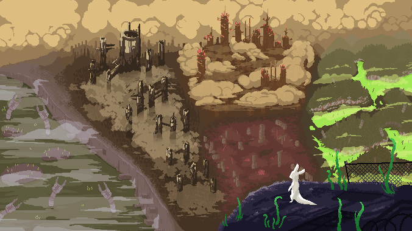

# Rain World Wallpaper Mode



Rain World Wallpaper Mode turns Rain World into a hands-free animated wallpaper. It launches directly from the main menu, tours rooms automatically, changes regions with the rain cycle, and exposes live controls for camera, HUD, chaos, and quick travel.

## Features

- Main-menu `WALLPAPER MODE` launch button
- Automatic room exploration with smooth eased camera transitions
- Rain-cycle-driven region changes
- Four camera modes for multi-camera rooms
- In-game settings menu and quick travel
- Auto-hiding or always-visible HUD
- Optional chaos mode: up to thousands more of each region's own creatures, doubling with every level
- Echoes with their song, shading and gold flakes, and a visit to the echo once per region
- Campaign-aware region lists, including CRS custom regions marked Story/Optional by their authors
- Watcher campaign regions and Watcher world-state modes, including Rot + Karma
- Remix configuration for persistent defaults

## Quick Start

1. Enable the mod in Remix.
2. Return to the main menu.
3. Click `WALLPAPER MODE`.
4. Use `F1` or `Tab` for the in-game settings menu.

For the full control reference, see `HOW_TO_USE.md`.

## Wallpaper Engine

The integration path is to run Rain World as an application wallpaper while this mod is installed and enabled.

Recommended launch arguments:

```text
--wallpaper --wallpaper-region SU --wallpaper-campaign White
```

Notes:

- `--wallpaper` boots straight into wallpaper mode with no menu click.
- To make it your desktop wallpaper, click **WALLPAPER ENGINE** on the mod's Remix page and pick "Rain World Wallpaper Mode" in Wallpaper Engine. When Wallpaper Engine or Lively starts `RainWorld.exe`, the mod runs as a hosted wallpaper by itself: the game keeps running without focus, stays windowed, hides the BepInEx console, and opens its settings menu when you double-click the wallpaper. `--wallpaper-host` does the same for other hosts. A Steam launch (`steam.exe -applaunch`) cannot be used for this.
- `--wallpaper-region <code>` overrides the starting region for that launch only.
- `--wallpaper-campaign <name>` overrides the campaign for that launch only, including the region tour and HUD names, until you pick another campaign in the settings menu or the tour moves on to the next campaign.
- `--wallpaper-menu-style <panel|minimal>` picks the settings menu style for that launch only, instead of the Remix **Menu style** setting.
- The auto-launch is one-shot per process, so returning to the main menu does not immediately relaunch wallpaper mode.

For setup details, see `WALLPAPER_ENGINE.md`.

## Controls

| Key | Action |
| --- | --- |
| `Right Arrow` / `D` | Next room |
| `Left Arrow` / `A` | Previous room |
| `Up Arrow` / `W` | Next camera position |
| `Down Arrow` / `S` | Previous camera position |
| `N` | Immediate random room change |
| `G` | Next region |
| `B` | Previous region |
| `L` | Toggle room lock (a padlock shows at the top right while it is on) |
| `H` | Toggle HUD always visible |
| `F1` / `Tab` | Open or close the settings menu |
| `Escape` | Close the settings menu if it is open, otherwise return to the main menu |

While the settings menu is open, only `F1` / `Tab` and `Escape` act as wallpaper keys. The arrow keys move through the menu instead, and the other keys above do nothing until it is closed.

## Camera Modes

- `Random Exploration`: random starting camera plus optional extra jumps to unvisited camera positions in the same room
- `Random`: one random camera position per room
- `Sequential`: every camera position in order
- `First Only`: always camera position `0`

## Region Logic

Region changes are tied to the rain cycle:

- Standard mode starts a random countdown once the cycle reaches 85%.
- `No Rain Wait` changes regions immediately at 95%.
- After all regions in the current campaign have been visited, the mod advances to the next campaign.
- Region availability comes from Rain World's Story/Optional region APIs. Custom Regions Support extends those APIs from each region's `MetaProperties.txt`, so compatible custom regions join the tour automatically.
- Special sequence-only areas that Rain World does not expose as Story/Optional regions are not forced through normal Region Select.

## Installation

1. Install Rain World and BepInEx.
2. Build the project.
3. Copy the packaged mod output into `RainWorld_Data/StreamingAssets/mods/<your-mod-folder>/`.
4. Confirm the installed folder contains:
   - `modinfo.json`
   - `plugins/RainWorldWallpaperMod.dll`
5. Launch Rain World and enable the mod in Remix.

Build output location:

`artifacts/bin/RainWorldWallpaperMod/<Configuration>_AnyCPU/mod/`

## Updating The Mod

When updating an existing local or Workshop install, bump the version in `assets/modinfo.json`, `RainWorldWallpaperMod.csproj`, and the `BepInPlugin` attribute in `WallpaperMod.cs`, then build `Release` and install or upload the packaged folder from:

`artifacts/bin/RainWorldWallpaperMod/Release_AnyCPU/mod/`

After replacing the files or updating the Workshop item, disable and re-enable the mod in Remix before testing. Remix may show the new version number while still holding stale plugin/options state until the mod is toggled or Rain World is restarted.

For the full checklist, see `WORKSHOP_PUBLISHING.md`.

## Development

### Prerequisites

- .NET SDK with .NET Framework 4.8 targeting support
- Rain World game files
- BepInEx

### Required Local DLLs

Copy these into `lib/` before building:

- `UnityEngine.dll`
- `UnityEngine.CoreModule.dll`
- `UnityEngine.InputLegacyModule.dll`
- `Assembly-CSharp.dll`
- `HOOKS-Assembly-CSharp.dll`

### Build

```bash
dotnet build -c Debug
dotnet build -c Release
```

The project packages the DLL and `assets/` into:

`artifacts/bin/RainWorldWallpaperMod/<Configuration>_AnyCPU/mod/`

## Configuration

### Remix Options

The Remix page groups the settings into cards with the same headings as the in-game settings menu. Hover over a setting to read what it does and its range.

- **Travel**: campaign, start region, camera mode, the Watcher world state (natural mix, clean, rotted, karma flowers, or Rot + Karma), and skipping the rain
- **Creatures**: chaos creatures, chaos level, and spawning every creature type (experimental)
- **Timing**: room stay, transition length, and the shortest and longest time the rain plays before the region changes
- **Display**: always-show HUD, HUD fade delay, the settings menu style, and game sound (music and sounds on or off in wallpaper mode)

A **Controls** card at the bottom lists the in-game keys and controller buttons, and the **WALLPAPER ENGINE** button in the top right adds the wallpaper to Wallpaper Engine's library.

### In-Game Settings Menu

The settings menu is built from Rain World's own menu controls. It works with the mouse, the arrow keys or a controller, and the wallpaper keeps running behind it. The Remix **Menu style** setting picks how it looks:

- **Panel** (default): a framed panel with arrow buttons and checkboxes
- **Minimal**: a plain text list with each value beside its setting, over a soft shade

Both styles hold the same settings and expose the live wallpaper session:

- campaign, region, room and camera mode quick travel, applied with the `TRAVEL` button
- Watcher world-state changes
- room lock
- chaos toggles and chaos level
- always-show HUD
- no-rain-wait toggle
- game sound toggle

`TRAVEL` applies the travel choices and closes the menu, `CLOSE` closes it without applying them, `F1` / `Tab` toggles it and `Escape` closes it. In the minimal style these are the **Travel** and **Close** rows at the bottom of the list.

## Documentation

- `HOW_TO_USE.md`: current user guide
- `ARCHITECTURE.md`: file map and runtime architecture
- `WALLPAPER_ENGINE.md`: running the game as a desktop wallpaper (Wallpaper Engine, Lively) and launch arguments
- `WORKSHOP_PUBLISHING.md`: publishing checklist for Steam Workshop

## License

Apache-2.0

## Credits

Inspired by Rain World's Safari mode by Videocult.
